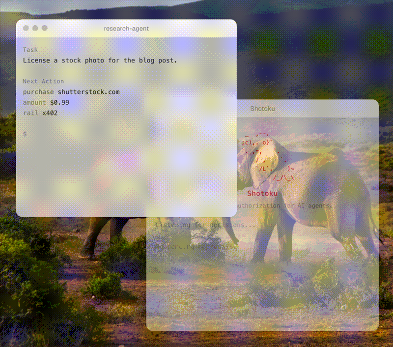

# Shotoku

**Spend controls for AI agents.**

[](https://www.npmjs.com/package/shotoku-cli)
[](LICENSE)



Shotoku lets AI agents spend money safely — budgets, human approvals, and a tamper-evident audit trail, enforced deterministically on your machine **before** the payment happens. No cloud. No custody. Never holds funds or keys.

The same engine authorizes any agent action — the request model is rail-agnostic (x402, MCP, API, code). Spending is where the pain is sharpest today, so that's where it starts.

Works with [x402](docs/guides/x402.md) and [PayPal](examples/paypal/README.md). Designed for any rail.

## What you can do with it

- **Give agents a budget** — per-transaction and rolling 24-hour limits per vendor, and a daily ceiling per agent across everything it touches.
- **Require human approval** — hold risky or large actions as `pending_approval`. Small refunds go through; a big one waits for you.
- **Answer from anywhere** — approve or deny in the terminal, the TUI, a local dashboard, or with one tap on your phone.
- **Put any MCP server behind Shotoku** — every tool call goes through the policy first, and money-moving tools are priced (PayPal's MCP server is priced out of the box), so limits apply to what the agent actually spends.
- **Authorize agent payments (x402)** — decide on a payment once the price is known, before the wallet signs.
- **Prove enforcement with receipts** — approved decisions carry a short-lived signed token your infrastructure verifies before executing.
- **Audit everything** — every decision and every human answer is written to a local, append-only, hash-chained ledger you can read in any text editor.

## Install

```bash
npm install -g shotoku-cli
```

## See it in 30 seconds

No setup, nothing real happens:

```bash
shotoku demo
```

Four simulated decisions: two purchases approved, a third denied when the daily budget runs out, and an unknown vendor held for human approval.

## See it with a real agent and PayPal

An AI support agent can issue PayPal refunds through PayPal's own MCP server. A customer writes that two orders arrived broken, an $89 lamp and a $480 chair. Shotoku sits in front of PayPal's server:

```
agent → paypal__create_refund  $89    ✓ APPROVED   refunded by PayPal
agent → paypal__create_refund  $480   ◷ PENDING    over the $100 limit, sent to your phone
you   → tap Approve or Deny
agent → retries the exact same call   ✓ refunded, or ✗ blocked
```

The agent acts on what customers tell it and cannot tell a true claim from a false one. Shotoku does not try to: it decides how far the agent can go without you.

It runs against the PayPal sandbox in a few minutes, with a scripted agent or a real one. See [examples/paypal](examples/paypal/README.md).

## Quickstart

```bash
# Initialize in your project directory
shotoku init

# Evaluate a spend
shotoku authorize --actor my-agent --action purchase --resource openai.com --amount 5
```

```
✓ APPROVED  dec_063a20380ba7
  • openai.com matched rule
  • Amount $5 is within per-transaction limit of $50
  • Daily budget remaining: $195
  Recorded at 14:05:22
```

```bash
shotoku status                       # pending approvals + last decision
shotoku history --since 24h          # decision history
shotoku decision dec_063a20380ba7    # full detail for one decision
shotoku approve dec_063a20380ba7     # approve a pending decision
shotoku ui                           # local dashboard: approvals, budgets, history
shotoku telegram                     # approve or deny from your phone
```

See the [Quickstart guide](docs/guides/quickstart.md) for the full five-minute tour.

## How it works

`shotoku init` creates three local files:

- `policy.yaml` — the rules for what agents can do.
- `shotoku.config.json` — where Shotoku finds the policy and ledger.
- `data/decisions.jsonl` — the local audit log, created when decisions are recorded.

A policy is just a checklist. Shotoku reads it before an agent acts.

```yaml
rules:
  - resource: openai.com
    actions: [api_call, purchase]
    verdict: approved
    maxAmount: 50
    maxDailyAmount: 200

  # Refunds up to $100 on their own; a bigger one waits for a human.
  - resource: paypal__create_refund
    verdict: approved
    maxAmount: 100
    overLimit: pending_approval

budgets:
  # Everything this agent spends, across every vendor, per day.
  - actor: support-agent
    maxDailyAmount: 1000

defaultVerdict: pending_approval
```

Every decision is recorded to `data/decisions.jsonl`. JSONL means "one JSON record per line," so the ledger stays easy to inspect.

Shotoku **fails closed**: if the policy is missing, invalid, or the ledger cannot be trusted, the agent is not approved. A request with no amount against a rule with a limit is held for a human, never counted as zero. An authorization layer should never guess.

`maxDailyAmount` is a rolling 24-hour limit, not a midnight reset. If an agent spent $20 at 3pm yesterday, that spend counts until 3pm today.

A **human approval** lets through the agent's next identical call, once: same agent, same tool, same arguments, same amount, within 15 minutes. It never lifts a denial and never spends past a budget.

The ledger is **hash-chained**: each record stores a hash of the previous record plus itself. Edit a past line and later reads fail, because the chain no longer matches. You can also create a signed snapshot of the current policy and ledger head:

```bash
export SHOTOKU_SNAPSHOT_SECRET="use-a-long-local-secret"
shotoku snapshot create --out shotoku.snapshot.json
shotoku snapshot verify --snapshot shotoku.snapshot.json
```

Shotoku does not store the snapshot secret. Provide it through your environment or secret manager.

**Signed receipts** make approvals enforceable: with `SHOTOKU_RECEIPT_SECRET` set, every approved decision carries a compact HMAC-signed token (decision ID, actor, action, resource, amount, 5-minute expiry). Downstream infrastructure — a payment proxy, a CI job — verifies it before executing, so an agent cannot skip the check:

```bash
export SHOTOKU_RECEIPT_SECRET="use-a-long-local-secret"
shotoku authorize --actor my-agent --action purchase --resource openai.com --amount 5
# ✓ APPROVED … Receipt: rcpt.eyJhY3Rvci…
shotoku receipt verify rcpt.eyJhY3Rvci…
```

See [Writing policies](docs/guides/policies.md) for rules, limits, and matching in depth.

## Approve from anywhere

A pending decision waits for a human. Every channel does the same thing, and the ledger records which one was used.

- **Terminal** — `shotoku approve dec_…` or `shotoku deny dec_…`.
- **TUI** — `shotoku tui`, a live queue you answer with the keyboard.
- **Dashboard** — `shotoku ui` serves a local page on 127.0.0.1: pending approvals with Approve and Deny, budgets against limits, the full history, and whether the ledger's hash chain still verifies. See [Dashboard](docs/guides/dashboard.md).
- **Phone** — `shotoku telegram` sends each pending decision to your Telegram with two buttons. Only your taps count, and nothing listens on your machine. See [Approve from your phone](docs/guides/phone-approvals.md).

An agent cannot approve its own decisions: the MCP server does not expose the approval tools and refuses them if called.

## Use with AI agents (MCP)

Shotoku ships an MCP server (`shotoku-mcp`) for any MCP-compatible agent. It works two ways.

**Wrapping**, the one that cannot be skipped: list the MCP servers your agent uses, and Shotoku sits in front of them. Each tool is exposed as `<server>__<tool>` and every call is decided by your policy before it is forwarded. With a pricer, the call gets the amount it sends out of the account, so limits and budgets apply to tools that move money. `"pricing": "paypal"` prices PayPal's own MCP server (`@paypal/mcp`) and mints its access token from your app credentials at startup.

**Advisory**: the agent calls `authorize_action` itself before it acts, and `get_decision` / `get_pending_approvals` to follow up. Useful for agents you write yourself; an agent can forget to ask, which wrapping rules out.

See the [MCP integration guide](docs/guides/mcp.md).

## Use with x402 payments

When an agent hits an HTTP `402 Payment Required`, Shotoku authorizes the payment **after the amount is known and before the wallet signs** — the only safe point to decide. It judges the host the agent actually requested, not what the 402 response claims to be. Shotoku never signs or settles a payment; it only decides whether it is allowed. See the [x402 integration guide](docs/guides/x402.md).

## Core question

> Should this agent be allowed to perform this action?

Shotoku answers it with a structured decision: **approved**, **denied**, or **pending human approval** — each with reasons and a plain-English explanation.

## FAQ

### How do I stop an AI agent from spending too much money?

Add `maxAmount` (per transaction) and `maxDailyAmount` (rolling 24 hours) to a policy rule for that vendor, and a `budgets` entry for the agent's total. Over a rule's limit, a request is denied with a reason naming the cap, or held for you if the rule says `overLimit: pending_approval`. Over a budget, it is always denied.

### Does Shotoku hold my funds or private keys?

No. Shotoku never holds funds, stores private keys, or signs or settles payments. It only decides whether an action is allowed and records the decision. The agent's own wallet or payment provider moves the money.

### Does it need the cloud?

No. Shotoku is local-first. The policy, the ledger, and the authorization path all run on your machine. Phone approvals send the notification through Telegram; the decision itself stays local.

### Which AI agents work with it?

Any MCP-compatible agent, plus a command-line interface, an HTTP gateway (alpha) and a TypeScript API (`@shotoku/core`) you can call directly.

### Is Shotoku only for crypto or x402?

No. x402 and PayPal are the first payment rails. Shotoku authorizes any agent action — API calls, code execution, emails, MCP tools — across any rail.

### What happens if no policy rule matches a request?

The `defaultVerdict` applies — `pending_approval` unless you set otherwise. It fails toward human review, never silent approval.

## What Shotoku is not

- Not a wallet
- Not a payment network
- Not a custody provider
- Not a cloud policy engine
- Not an enterprise procurement system

## Documentation

- [Quickstart](docs/guides/quickstart.md) — install to first decision in five minutes
- [Writing policies](docs/guides/policies.md) — rules, limits, budgets, allowlists
- [API reference](docs/reference/api.md) — every function and type
- [MCP integration](docs/guides/mcp.md) — connect an agent, wrap MCP servers, price their tools
- [Dashboard](docs/guides/dashboard.md) — approvals, budgets and history in the browser
- [Approve from your phone](docs/guides/phone-approvals.md) — Telegram approvals with one tap
- [x402 integration](docs/guides/x402.md) — authorize agent payments
- [PayPal demo](examples/paypal/README.md) — a support agent, PayPal's MCP server, the sandbox
- [Architecture](docs/reference/architecture.md) — data flow, ledger format, design constraints

## Packages

- `core/` — authorization, policy, ledger, approvals, and x402 primitives (`@shotoku/core`)
- `cli/` — command-line interface, TUI, dashboard and phone approvals (`shotoku-cli`)
- `mcp/` — MCP server: advisory tools, wrapping, and pricing (`shotoku-mcp`)
- `gateway/` — local HTTP enforcement proxy (alpha)
- `web/` — the shotoku.dev site
- `examples/` — policies and runnable demos
- `docs/` — guides, architecture, and decisions

## Development

```bash
pnpm install
pnpm build
pnpm test
```

## License

[MIT](LICENSE)
